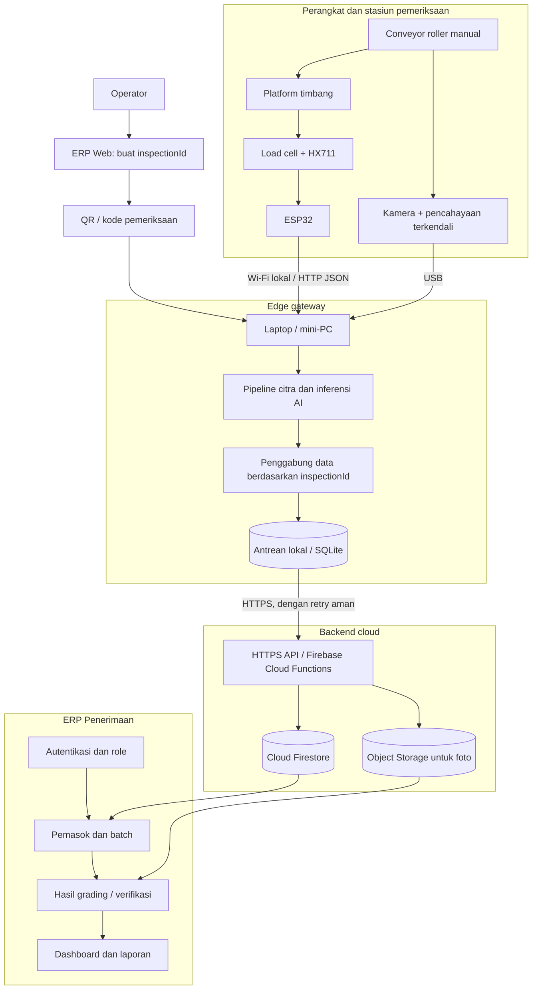

# Spesifikasi Konsep Sistem v1.0

## Conveyor Grading TBS Berbasis Multi-Sensor, Computer Vision, dan IoT dengan Integrasi ERP Penerimaan

**Status:** rancangan konseptual untuk didiskusikan dan menjadi dasar prototipe; belum merupakan desain teknik final dan belum menjadi klaim novelty final.

## 1. Ringkasan konsep

Sistem dirancang sebagai prototipe conveyor semi-manual yang memeriksa Tandan Buah Segar (TBS) satu tandan per siklus. Beberapa stasiun menghasilkan data pemeriksaan yang digabungkan memakai ID pemeriksaan yang sama. Hasil sensor dan prediksi computer vision diproses oleh edge gateway, lalu dikirim melalui backend ke modul ERP penerimaan. ERP menyimpan data mentah, hasil prediksi, hasil verifikasi operator, dan grade akhir sebagai informasi yang berbeda.

### Tujuan

1. Menyusun proses grading TBS menjadi tahapan yang terstruktur.
2. Mengakuisisi parameter terpilih secara otomatis melalui sensor dan computer vision.
3. Menggabungkan hasil dari beberapa stasiun untuk satu tandan atau batch tanpa tertukar.
4. Mencatat hasil grading secara otomatis ke modul ERP penerimaan.
5. Mengevaluasi kinerja grading serta keandalan integrasi data secara end-to-end.

### Bukan tujuan MVP

- Mengotomatisasi semua proses dan modul ERP perusahaan.
- Menentukan harga atau penalti secara universal tanpa konfigurasi aturan yang disahkan.
- Mengklaim bahwa kamera dapat mengukur kadar ALB/FFA atau rendemen minyak secara langsung.
- Memisahkan atau mengalihkan TBS secara mekanis otomatis.
- Mengklaim akurasi AI tertentu sebelum eksperimen dilakukan.

## 2. Prinsip desain

- **Satu pemeriksaan, satu ID:** semua data stasiun harus terkait dengan `inspectionId` yang sama.
- **Satu tandan per siklus MVP:** menyederhanakan pencocokan label, berat, foto, dan hasil akhir.
- **Pisahkan fakta dan prediksi:** berat sensor, prediksi AI, koreksi operator, dan grade akhir disimpan terpisah.
- **Grade mengikuti aturan versi tertentu:** standar/acuan grading ditetapkan dan diberi versi; perubahan aturan tidak menghapus hasil historis.
- **Human-in-the-loop:** operator dapat mengoreksi prediksi dengan alasan, dan sistem mencatat jejak koreksinya.
- **Offline-tolerant:** gateway dapat menyimpan data sementara saat internet terputus dan mengirimkannya ulang.
- **MVP modular:** beberapa proses dapat berada dalam satu ruang inspeksi; tidak setiap proses memerlukan controller atau conveyor terpisah.

## 3. Cakupan grading

### 3.1 Cakupan konseptual

Sistem dirancang agar dapat menangani kelompok parameter berikut, dengan kemampuan otomatis yang harus divalidasi satu per satu:

1. Fraksi kematangan TBS.
2. Berat tandan, bila diperlukan untuk pencatatan atau aturan tertentu.
3. Panjang tangkai.
4. Kondisi fisik visual, misalnya buah rusak/busuk yang terlihat.
5. Tandan kosong dan kotoran yang terlihat.

### 3.2 Pembatasan MVP

**Prioritas otomatisasi awal:** pengukuran berat dan pengambilan citra terkontrol untuk estimasi kematangan visual.

**Parameter eksploratif:** deteksi tandan kosong/buah rusak secara visual dan pengukuran panjang tangkai. Fitur ini dimasukkan sebagai target lanjutan atau eksperimen terpisah apabila dataset, definisi label, dan metode ukur tersedia.

Kelas fraksi pada label harus mengikuti satu dokumen acuan yang dipilih. Kriteria fraksi, penentuan buah luar yang membrondol, kriteria sortasi, dan aturan penalti bisa berasal dari dokumen yang berbeda. Jangan mencampurkan nilai batas dari sejumlah sumber menjadi satu standar yang seolah-olah universal. Sampai acuan ditetapkan, output model disebut **estimasi fraksi visual**, bukan keputusan grading resmi.

## 4. Alur mekanis

1. **Input dan identifikasi:** operator membuat pemeriksaan melalui ERP/gateway, lalu QR atau kode pemeriksaan dikaitkan dengan tandan/batch.
2. **Posisi timbang:** conveyor dihentikan atau tandan ditempatkan pada platform timbang yang terisolasi secara mekanis. Sistem menunggu pembacaan stabil sebelum menyimpan berat.
3. **Inspeksi visual:** tandan berada dalam area dengan pencahayaan terkendali. Kamera mengambil citra dari sudut yang dirancang; operator boleh memutar tandan secara manual pada MVP.
4. **Analisis:** model memproses citra dan mengeluarkan prediksi kelas, confidence, serta hasil deteksi yang didukung model.
5. **Penggabungan:** gateway mengaitkan berat, metadata citra, hasil model, dan ID pemeriksaan.
6. **Verifikasi:** hasil yang confidence-nya rendah, citranya tidak layak, atau memiliki konflik data ditandai untuk diperiksa operator.
7. **Pencatatan:** hasil yang lolos validasi dikirim ke backend dan disimpan di ERP.
8. **Penutupan pemeriksaan:** hasil final dikunci dengan jejak audit; koreksi selanjutnya disimpan sebagai revisi, bukan menimpa jejak sebelumnya.

### Catatan mekanis

- Gunakan satu tandan per siklus untuk MVP.
- Platform load cell harus memiliki jalur beban yang jelas dan tidak berbagi beban dengan rangka conveyor lain saat menimbang.
- Jangan membaca berat ketika tandan masih membebani roller yang bergerak.
- Ruang inspeksi perlu pencahayaan LED difus yang konstan serta latar yang membantu pemisahan objek dari latar.
- Mulai dari 1–2 kamera atau satu kamera dengan pengambilan beberapa sudut secara manual. Tentukan penambahan kamera setelah uji awal menunjukkan blind spot.
- Pemilahan fisik hasil berdasarkan grade masih dilakukan operator; aktuator sortir otomatis berada di luar MVP.

## 5. Arsitektur tingkat tinggi



### Pilihan komponen awal

- **Sensor berat:** load cell dengan kapasitas yang ditentukan dari rentang berat TBS yang akan diuji, modul HX711, dan ESP32.
- **Kamera:** USB camera yang kompatibel dengan gateway; resolusi final dipilih setelah uji ketajaman citra dan jarak kamera.
- **Pencahayaan:** LED putih difus di scanning hood/ruang inspeksi.
- **Edge gateway:** laptop pengembangan yang tersedia; mini-PC dapat dipertimbangkan bila prototipe membutuhkan instalasi mandiri.
- **AI:** Python + OpenCV untuk pipeline citra; model klasifikasi/deteksi dipilih setelah peninjauan dataset, bukan dikunci terlebih dahulu.
- **Web ERP:** Next.js.
- **Identitas pengguna:** Firebase Authentication.
- **Backend:** Node.js API pada Firebase Cloud Functions HTTPS.
- **Data terstruktur:** Cloud Firestore.
- **Foto:** Firebase Storage atau object storage yang setara.
- **Antrean lokal:** SQLite pada gateway untuk data belum terkirim.

Referensi teknis Firebase: HTTP Functions mendukung endpoint HTTP untuk integrasi API, sedangkan Firestore menyediakan operasi penetapan, penambahan, dan pembaruan dokumen. Detail implementasi tetap harus mengikuti dokumentasi resmi yang berlaku saat pembangunan.

## 6. Arsitektur komunikasi

### 6.1 Perangkat ke gateway

ESP32 membaca berat setelah pembacaan stabil, lalu mengirim payload lokal yang berisi ID pemeriksaan, ID perangkat, nilai berat, unit, waktu, dan status sensor. Gateway menerima payload, memvalidasi tipe data dan ID, kemudian menyimpannya ke antrean pemeriksaan.

Kamera terhubung melalui USB ke gateway. Gateway menangani akuisisi gambar, penyimpanan citra sementara, prapemrosesan, dan inferensi model AI.

### 6.2 Gateway ke backend

Gateway mengirim hasil pemeriksaan melalui HTTPS. Setiap operasi tulis membawa `eventId` atau kunci idempotensi agar pengiriman ulang akibat koneksi putus tidak membuat data ganda.

Jika koneksi internet gagal:

1. simpan hasil lengkap beserta waktu dan ID secara lokal;
2. tandai status `sync_pending`;
3. coba kirim ulang ketika koneksi pulih;
4. tandai `synced` setelah server mengonfirmasi data tersimpan;
5. jangan menghapus salinan lokal sebelum konfirmasi diterima.

### 6.3 Backend ke ERP

Backend memeriksa otorisasi, format payload, kelengkapan data wajib, hubungan `inspectionId` dan `batchId`, serta duplikasi. ERP membaca data hasil validasi. Perangkat tidak diberi kredensial administrator database.

## 7. Status siklus pemeriksaan

Gunakan state machine sederhana:

`created → collecting → processing → awaiting_review → finalized → synced`

Status alternatif:

- `needs_retake`: citra tidak layak atau pemeriksaan gagal.
- `needs_review`: model tidak yakin atau data antarestasiun tidak konsisten.
- `sync_pending`: pemeriksaan final belum berhasil dikirim ke cloud.
- `error`: kegagalan perangkat atau pengolahan yang perlu ditangani.

Hanya pemeriksaan dengan data wajib lengkap dan aturan validasi terpenuhi yang dapat difinalisasi. `finalGrade` dapat tetap kosong ketika operator belum memverifikasi hasil.

## 8. Kontrak data

Contoh payload hasil pemeriksaan (data ilustratif, bukan hasil pengujian):

```json
{
  "inspectionId": "GRD-00001",
  "batchId": "BATCH-2026-001",
  "deviceId": "GATEWAY-01",
  "createdAt": "2026-10-20T08:00:00Z",
  "measurements": {
    "weight": { "value": 12.5, "unit": "kg", "source": "load_cell" }
  },
  "visionResult": {
    "maturityEstimate": { "class": "F2", "confidence": 0.87 },
    "visibleDefects": [],
    "imageRefs": ["storage/path/image-01.jpg"],
    "modelVersion": "baseline-01"
  },
  "gradingRulesVersion": "rules-01",
  "review": {
    "required": true,
    "verified": false,
    "reviewerId": null,
    "correctionReason": null
  },
  "finalGrade": null,
  "syncStatus": "pending"
}
```

Ketentuan kontrak:

- Satuan wajib eksplisit dan konsisten.
- Simpan nilai mentah sensor dan hasil olahan/prediksi secara terpisah.
- `confidence` adalah skor model, bukan probabilitas benar yang sudah terkalibrasi kecuali kalibrasi tersebut memang dilakukan.
- Simpan versi model AI dan versi aturan grading agar hasil dapat direproduksi.
- Foto besar disimpan di object storage; Firestore hanya menyimpan referensi serta metadata foto.
- Data koreksi operator tidak boleh menghapus prediksi awal.
- Waktu dicatat dalam format waktu standar (UTC) dan disajikan kepada pengguna dalam zona waktu lokal aplikasi.

## 9. Model data Firestore yang disarankan

### `suppliers/{supplierId}`

- `name`
- `supplierType`
- `originDescription` (opsional)
- `active`
- `createdAt`

### `batches/{batchId}`

- `supplierId`
- `arrivalAt`
- `vehicleId` (opsional)
- `receiptStatus`
- `inspectionIds[]` (opsional untuk pencarian mudah; sumber hubungan utama tetap dicatat per inspection)
- `createdAt`, `createdBy`

### `inspections/{inspectionId}`

- `batchId`, `supplierId`, `deviceId`
- `status`, `createdAt`, `completedAt`
- `measurements` (nilai dan metadata sensor)
- `visionResult` (hasil inferensi dan referensi citra)
- `gradingRulesVersion`, `modelVersion`
- `suggestedGrade`, `finalGrade`
- `review` (status, reviewer, waktu, alasan koreksi)
- `syncStatus`, `lastError` (bila ada)

### `devices/{deviceId}`

- `deviceType`, `firmwareVersion`, `lastSeenAt`, `status`
- Jangan menyimpan rahasia perangkat dalam dokumen yang dapat dibaca klien umum.

### `gradingRules/{rulesVersion}`

- `sourceDocument`
- `effectiveDate`
- `classes`
- `thresholds`
- `reviewedBy`
- `notes`

Aturan harus menaut ke dokumen acuan yang nyata dan tidak boleh diisi dengan potongan harga hasil perkiraan.

### `auditEvents/{eventId}`

- `inspectionId`
- `eventType`
- `actorId`
- `timestamp`
- `before` dan `after` bila relevan
- `reason`

Firestore cocok untuk prototipe yang menyimpan dokumen pemeriksaan dan hasil stasiun. Struktur akhir masih harus diuji terhadap pola kueri, keamanan, retensi foto, dan kebutuhan laporan.

## 10. API awal

Semua endpoint di bawah adalah kontrak konseptual; bukan endpoint yang sudah diimplementasikan.

| Method | Endpoint | Kegunaan |
|---|---|---|
| `POST` | `/api/inspections` | Membuat pemeriksaan baru dan mengembalikan `inspectionId`. |
| `GET` | `/api/inspections/{inspectionId}` | Mengambil detail pemeriksaan. |
| `POST` | `/api/inspections/{inspectionId}/station-results` | Mencatat hasil dari stasiun tertentu. Wajib ada `eventId` dan `stationId`. |
| `POST` | `/api/inspections/{inspectionId}/vision-results` | Mengirim hasil inferensi dan referensi citra. |
| `POST` | `/api/inspections/{inspectionId}/finalize` | Memvalidasi serta memfinalisasi hasil sesuai aturan grading. |
| `POST` | `/api/inspections/{inspectionId}/review` | Merekam koreksi/konfirmasi operator beserta alasan. |
| `GET` | `/api/reports/grading` | Mengambil agregasi laporan berdasar rentang tanggal, grade, atau pemasok. |
| `GET` | `/api/devices/{deviceId}/status` | Mengambil status perangkat/gateway jika fitur monitoring dipakai. |

Persyaratan API:

- Validasi skema dan jenis data pada server.
- Autentikasi pengguna dan kredensial perangkat dipisahkan.
- Gunakan batas akses berdasarkan role.
- Terapkan idempotensi pada pengiriman ulang.
- Jangan menerima `finalGrade` dari perangkat sebagai fakta final tanpa validasi aturan dan status review.
- Batasi ukuran foto dan kirim file melalui mekanisme upload yang sesuai; simpan metadata/referensi di Firestore.
- Log kesalahan tanpa membocorkan kredensial atau data rahasia.

## 11. Pipeline AI dan penyiapan dataset

1. Tetapkan dokumen acuan grading dan definisi setiap kelas.
2. Tentukan unit sampel: satu tandan unik dengan beberapa citra dari sudut berbeda.
3. Berikan label referensi oleh grader berpengalaman berdasarkan dokumen yang dipilih. Sediakan proses adjudikasi ketika label penilai berbeda.
4. Simpan metadata foto, ID tandan, kondisi pencahayaan, tanggal, serta penilai.
5. Bagi dataset berdasarkan ID tandan, bukan gambar, untuk menghindari citra dari tandan yang sama bocor ke pelatihan dan pengujian.
6. Mulai dari baseline sederhana lalu bandingkan model yang lebih sesuai setelah karakteristik dataset diketahui.
7. Ukur confusion matrix, precision, recall, macro-F1, serta performa per kelas. Catat juga kebutuhan `needs_review` dan `needs_retake`.
8. Uji data dari kondisi pengambilan gambar yang berbeda, tetapi tetap sesuai batas operasi yang ditetapkan.
9. Versikan model dan aturan grading. Setiap hasil harus bisa dilacak ke versi yang menghasilkannya.

Saran pembagian 80:20 bisa dipakai sebagai baseline awal bila ukuran data mencukupi, tetapi konfigurasi train/validation/test ditetapkan mengikuti desain dataset. Jangan menetapkan target akurasi sebagai standar umum; tetapkan target proyek setelah baseline, label, dan ukuran sampel disepakati.

## 12. Rencana validasi MVP

| Pengujian | Metode | Metrik |
|---|---|---|
| Timbangan | Bandingkan dengan alat referensi pada beberapa tingkat beban dan pengulangan | Galat absolut/relatif, repeatability |
| AI grading | Bandingkan prediksi pada data uji tandan terpisah dengan label ahli | Macro-F1, precision, recall, confusion matrix, per-class recall |
| Kondisi citra | Bandingkan pengambilan citra dengan sudut/orientasi berbeda | Perubahan performa per kelas, proporsi retake |
| Kecepatan | Ukur dari mulai pemeriksaan hingga hasil tersedia | Waktu per tandan, throughput |
| Integrasi | Jalankan pemeriksaan beruntun dan injeksikan gangguan koneksi | Persentase berhasil, data hilang/duplikat, latency, waktu pemulihan |
| Ketertelusuran | Audit sampel dari perangkat ke dokumen ERP | Persentase rekaman yang terhubung pada ID yang tepat |
| Human review | Bandingkan hasil AI, koreksi, dan grade akhir | Frekuensi koreksi, alasan koreksi, per kelas |

Semua target numerik perlu ditetapkan setelah uji awal, ketersediaan sampel, kemampuan perangkat, dan kriteria keberhasilan riset disepakati.

## 13. Keamanan dan reliabilitas

- Gunakan Firebase Authentication dan role untuk pengguna ERP.
- Validasi akses pada backend; jangan mengandalkan UI sebagai satu-satunya kontrol.
- Perangkat tidak menggunakan kredensial administrator database.
- Pisahkan autentikasi gateway/perangkat dari autentikasi operator.
- Gunakan HTTPS untuk koneksi gateway ke backend.
- Terapkan idempotensi, retry dengan jeda, dan penyimpanan antrean lokal.
- Catat versi model, versi aturan grading, waktu perangkat/server, serta event koreksi.
- Jangan menimpa rekaman final tanpa audit trail.
- Batasi akses foto dan tetapkan retensi data yang masuk akal.

## 14. Risiko teknis utama

| Risiko | Dampak | Mitigasi awal |
|---|---|---|
| Definisi fraksi berbeda antaracuan | Label tidak konsisten | Pilih dan dokumentasikan satu acuan untuk dataset; konfigurasi aturan dengan versi. |
| Citra hanya melihat sebagian tandan | Salah prediksi kematangan/cacat | Ruang inspeksi terkendali, beberapa sudut, operator memutar tandan, analisis error. |
| Model tidak punya cukup contoh kelas jarang | Recall kelas tertentu rendah | Pengumpulan data per kelas dan pelaporan metrik per kelas. |
| Timbangan terganggu rangka conveyor | Galat berat | Platform timbang terisolasi dan kalibrasi dengan alat referensi. |
| ID hasil stasiun tertukar | Data ERP tidak dapat dipercaya | Satu inspectionId per siklus, validasi urutan, audit log, pengujian skenario salah-ID. |
| Internet tidak stabil | Data terlambat/hilang | SQLite lokal, antrean, idempotensi, retry dan status sinkronisasi. |
| Scope terlalu besar | Prototipe tidak selesai | Satu tandan per siklus, berat + inspeksi visual, parameter lanjutan berdasarkan bukti. |
| Novelty terlalu generik | Proposal lemah | Bandingkan metode/mesin terdahulu dan klaim hanya pembeda yang benar-benar diuji. |

## 15. Batas MVP dan pengembangan lanjutan

### MVP

- Conveyor manual untuk satu tandan per siklus.
- ID pemeriksaan yang mengaitkan data seluruh stasiun.
- Pengukuran berat otomatis.
- Pengambilan beberapa sudut citra dengan pencahayaan terkontrol.
- Estimasi fraksi kematangan visual sebagai target AI utama.
- Verifikasi/koreksi operator.
- Backend, penyimpanan data/foto, modul ERP penerimaan dan grading.
- Dashboard riwayat dan laporan.
- Pengujian akurasi, waktu, serta integrasi end-to-end.

### Ekstensi setelah MVP

- Deteksi otomatis tangkai panjang, tandan kosong, dan cacat visual tambahan.
- Tambahan kamera atau mekanisme roller untuk mengubah orientasi tandan.
- Sortasi fisik dengan aktuator.
- Integrasi ke ERP pihak ketiga.
- Analisis keterkaitan grade dengan hasil proses pabrik, jika tersedia data mutu laboratorium yang valid.

## 16. Keputusan yang harus dibekukan sebelum mulai membangun

1. Dokumen acuan grading dan definisi label yang dipakai.
2. Kelas target model AI pada MVP.
3. Apakah deteksi cacat tambahan termasuk eksperimen MVP atau ekstensi.
4. Mekanisme citra: kamera dan tandan diputar manual, atau penambahan kamera/roller.
5. Rentang berat yang akan diukur dan kapasitas load cell.
6. Pola identifikasi: satu tandan per inspectionId, dengan relasi ke batch penerimaan.
7. Stack prototipe: ESP32 + HX711, laptop gateway + Python/OpenCV, Next.js + Firebase.
8. Jumlah serta cara pengumpulan sampel, prosedur pelabelan, dan rancangan evaluasi.
9. Batas keberhasilan numerik yang realistis setelah uji awal.
10. Jadwal pengembangan prototipe yang berjalan paralel dengan penyusunan proposal.

## 17. Kaitan dengan research gap

Riset Makky dan Soni (2013) telah mengembangkan mesin grading TBS berbasis machine vision yang terdiri dari subsistem mekanis, pemrosesan citra, deteksi, dan kontrol; penelitian itu juga mengevaluasi klasifikasi kelompok dan fraksi. Oleh karena itu, conveyor dan AI grading saja bukan klaim novelty yang cukup.

Arah yang masih perlu diuji adalah kontribusi gabungan sistem: pemeriksaan multi-stasiun, pengaitan hasil sensor dan prediksi pada tingkat tandan, pencatatan otomatis ke ERP penerimaan, penyimpanan provenance prediksi/koreksi, serta evaluasi kinerja grading dan integrasi secara end-to-end. Ini adalah hipotesis research gap yang harus diuji melalui tinjauan literatur lebih lengkap, bukan klaim kebaruan final.

## 18. Referensi awal

1. Makky, M., & Soni, P. (2013). *Development of an automatic grading machine for oil palm fresh fruits bunches (FFBs) based on machine vision*. Computers and Electronics in Agriculture, 93, 129–139. https://doi.org/10.1016/j.compag.2013.02.008
2. Firebase. *Call functions via HTTP requests*. https://firebase.google.com/docs/functions/http-events
3. Firebase. *Add data to Cloud Firestore*. https://firebase.google.com/docs/firestore/manage-data/add-data

**Catatan:** referensi standar teknis grading yang dipakai sebagai label dataset wajib ditetapkan secara spesifik dan diverifikasi sebelum proposal final disusun.
